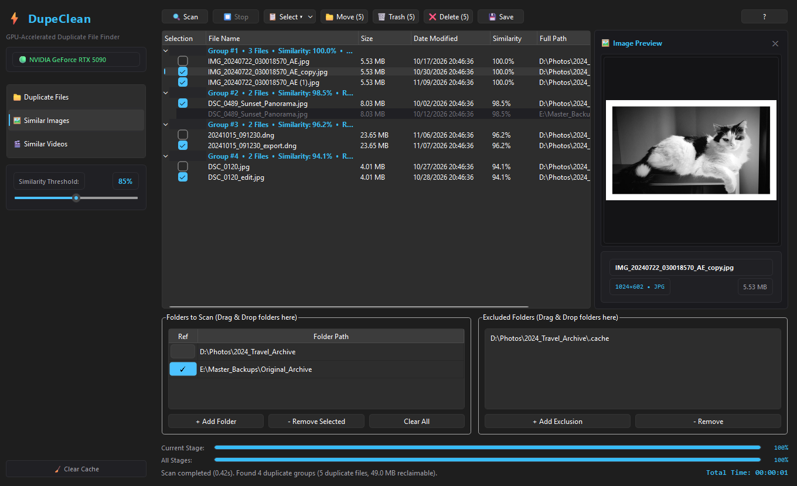

# DupeClean ⚡

**GPU-Accelerated Duplicate File Finder**

[](https://github.com/MarcSant71/DupeClean/releases/latest)
[](https://github.com/MarcSant71/DupeClean/releases/latest)
[](https://github.com/MarcSant71/DupeClean/releases/latest)

High-performance duplicate file, image, and video finder engineered and optimized exclusively for **NVIDIA GeForce RTX (30, 40, and 50 Series)** GPUs with Ampere, Ada Lovelace, and Blackwell architectures.

> 📦 **Portable Release (No Python Installation Required):**  
> Download the pre-built standalone package [**`DupeClean-v1.1.15-windows-cuda.7z`**](https://github.com/MarcSant71/DupeClean/releases/latest), extract with [7-Zip](https://www.7-zip.org/) or WinRAR, and run `DupeClean.exe` directly.

<p align="center">
  
</p>

---

## ⚡ Why DupeClean? (DupeClean vs. Traditional Tools)

Most popular deduplicators (Czkawka, dupeGuru, Duplicate Cleaner, etc.) were built for a previous computing era: they run all image hashing, vector calculations, and video decoding on the **CPU**. 

When scanning libraries with **100,000+ RAW photos or 4K videos**, legacy tools spike CPU usage to 100%, trigger thermal throttling, spin fans at maximum speed, and take **hours or days** - while your multi-thousand-dollar GPU sits completely idle.

**DupeClean changes the paradigm by moving the entire workload into dedicated NVIDIA silicon:**

| Feature | 🐢 Traditional Tools (Czkawka, dupeGuru, etc.) | ⚡ DupeClean (GPU-Accelerated) |
| :--- | :--- | :--- |
| **Compute Engine** | CPU-bound (Software loop, high thermal load) | **GPU Tensor Cores & CUDA** (Batches executed in VRAM) |
| **Similarity Intelligence** | Basic low-res pixel hashes (Gradient/Blockhash) | **GPU Frequency Signatures (2D DCT)** via PyTorch |
| **Throughput & Speed** | ~20–50 images/second (CPU bottlenecked) | **600+ images/second** (Parallel decoding + GPU compute) |
| **Video Keyframe Extraction** | Full sequential decoding (Slow, heavy lag) | **Fast Keyframe Seek + GPU Signatures** (150+ videos/s) |
| **UI Design Philosophy** | Crowded interfaces with dozens of technical options | **KISS Principle**: Clean dark mode, zero fluff, instant feedback |
| **Caching Pipeline** | In-memory or fragile cache | **SQLite WAL Engine**: Resumable, crash-safe, instant rescans |

---

## 🚀 Engineering Highlights

* **Zero CPU Bottlenecks:** Frequency feature extraction, normalizations, and similarity comparisons execute directly in GPU **VRAM** and **Tensor Cores** via PyTorch CUDA.
* **Parallel Multi-Process Extraction:** Multi-threaded image decoding feeds the GPU, while temporal video keyframe extraction pinpoints 5 distinct timeline samples without reading full files.
* **Reference Folder Protection (`Ref`):** Designate any master/backup folder as a **Reference**. DupeClean matches duplicate files against it, while ensuring reference files are strictly locked and never marked for deletion.
* **Modern Ergonomics & Usability:**
  * Clean, native Dark Theme (KISS principle).
  * Drag & Drop folder support from Windows Explorer.
  * Similarity threshold slider (70% to 100%) for perceptual image and video matching.
  * Safe file deletion via the Windows Recycle Bin (`Send2Trash`).

---

## 🔬 Specialized Pipeline Architecture (By Scan Mode)

DupeClean achieves extreme deduplication throughput by strictly assigning each task to the processor architecture best equipped for it: **CPU for parallel micro-sampling and sequential I/O; GPU Tensor Cores for mass similarity calculations and matrix grouping.**

Every scan operates in **3 distinct, deterministic stages**, tailored specifically to the data type being processed:

| Stage | 📁 Duplicate Files (Exact) | 🖼️ Similar Images (Visual) | 🎬 Similar Videos (Temporal) |
| :--- | :--- | :--- | :--- |
| **Stage 1/3**<br>*(Discovery)* | **Scanning Folders**<br>Exact file-size bucket grouping | **Scanning Folders**<br>Image format indexing & spatial sort | **Scanning Folders**<br>Video container & DVR crawl |
| **Stage 2/3**<br>*(Sieve & Signatures)* | **Calculating Partial Hashes**<br>Direct full hash &le; 256 KB; 8 KB Head+Tail sieve above | **Extracting Visual Signatures**<br>2D DCT Frequency Hash (GPU FP16) | **Extracting Video Signatures**<br>5-Keyframe Micro-Seek (PyAV + GPU) |
| **Stage 3/3**<br>*(Verification & Math)* | **Calculating Full Hashes**<br>Parallel 512 KB streaming `xxHash64` | **Comparing Visual Similarity**<br>All-to-all Cosine Matrix (VRAM) | **Comparing Video Similarity**<br>Temporal Tensor Core Matching |
| **Result Phase** | **$O(1)$ Hash Table Grouping**<br>Bit-for-bit identical clusters | **Mutual Similarity Grouping**<br>Perceptual clusters (70%–100% slider)| **Mutual Similarity Grouping**<br>Strict anti-chaining cluster isolation |

---

### 1. 📁 Duplicate Files Mode (1:1 Bit-for-Bit Exact Match)

* **Stage 1/3: Scanning Folders (Discovery & File-Size Grouping):**
  * Crawls selected folders, applies exclusion rules, protects **Reference Folders** (`Ref`), and isolates files by exact byte size.
  * Files with unique file sizes are immediately eliminated without touching disk storage.
* **Stage 2/3: Calculating Partial Hashes (256 KB Fast-Path, 8 KB Head + Tail Sieve & SQLite WAL Cache):**
  * Consults the persistent local SQLite WAL database (`DupeClean.db`).
  * Small and medium uncached files (`<= 256 KB`) are read once in full (`xxHash64`), resolving immediately in Stage 2 without reopening in Stage 3.
  * For larger uncached candidates (`> 256 KB`) with identical sizes, reads the first 4 KB and last 4 KB to compute an instant composite `xxHash64` partial hash.
  * **Efficiency:** Eliminates double-open overhead on tiny/medium files while discarding over **90% of non-duplicate large candidates** in less than 1 millisecond per file.
* **Stage 3/3: Calculating Full Hashes (Parallel Streaming & I/O Scaling):**
  * For remaining larger candidates (`> 256 KB`) passing the 8 KB sieve, reads complete file contents using pre-allocated 512 KB streaming buffers (`buffering=0` with `readinto`) to avoid per-chunk allocations and Python buffering overhead.
  * Dynamically scales concurrent reader threads to your CPU (`4` to `32` threads based on `os.cpu_count()`), saturating available disk bandwidth to compute high-speed `xxHash64` digests in minimum time.
* **Result Phase:** Instantaneous $O(1)$ in-memory hash table clustering. 100% bit-for-bit identical guarantee with zero GPU load.

---

### 2. 🖼️ Similar Images Mode (Perceptual 2D DCT on GPU)

* **Stage 1/3: Scanning Folders (Image Discovery & Spatial Sorting):**
  * Gathers photos and graphics (`.jpg`, `.png`, `.webp`, `.tiff`, `.bmp`, `.raw`), filters corrupted files, and applies parent directory sorting for optimal NTFS seek efficiency.
* **Stage 2/3: Extracting Visual Signatures (Parallel Decoding & GPU Tensor Hashing):**
  * Consults SQLite WAL cache for pre-computed 1,536-byte visual feature vectors.
  * Multi-threaded CPU workers (`4` to `32` threads) decode uncached images, convert them to normalized grayscale/RGB tensors, and transfer batches (`256`–`1,024` items depending on VRAM) to GPU VRAM.
  * NVIDIA RTX Tensor Cores compute **2D Discrete Cosine Transform (2D DCT)** frequency signatures in half-precision (FP16) in less than 0.5 ms per batch.
* **Stage 3/3: Comparing Visual Similarity (Mass Tensor Core Matrix Multiplication):**
  * All image vectors reside in GPU VRAM as a contiguous matrix.
  * The GPU executes all-to-all cosine similarity matrix multiplication across the entire dataset simultaneously.
* **Result Phase:** Applies **Mutual Similarity Grouping** based on the interactive similarity slider (70% to 100%). Identifies duplicates even across different resolutions, crops, color adjustments, or format conversions (e.g., RAW vs JPEG).

---

### 3. 🎬 Similar Videos Mode (Multi-Point Keyframe Extraction & Temporal GPU Clustering)

* **Stage 1/3: Scanning Folders (Container Discovery & Metadata Crawl):**
  * Enumerates video files across all common formats (`.mp4`, `.mkv`, `.avi`, `.mov`, `.wmv`) as well as raw surveillance DVR containers (`.dav`).
* **Stage 2/3: Extracting Video Signatures (PyAV Temporal Micro-Sampling + GPU Embeddings):**
  * Consults cache for 7,680-byte multi-keyframe temporal embeddings.
  * **Balanced Multi-Core Architecture:** Automatically allocates half of your CPU threads to seek and decode exactly **5 distinct temporal keyframes** across each video's duration (1–2 ms per keyframe) without decoding the entire video stream.
  * Extracted keyframes are batched to the GPU to generate concatenated 2D DCT frequency vectors.
* **Stage 3/3: Comparing Video Similarity (High-Dimensional Temporal Tensor Matching):**
  * Matches multi-point temporal vectors across candidate videos in GPU VRAM.
  * Evaluates sequence-wide structural similarity across all sampled keyframes.
* **Result Phase:** Applies strict **Mutual Similarity Grouping** to guarantee that every video in a cluster directly matches all other videos in that cluster, completely eliminating transitive false-positive chaining.

---

### 💡 Frequently Asked Questions on Hardware Usage

#### *"Why does Duplicate Files run two hashing stages (Partial Hashes vs. Full Hashes)?"*
To mathematically guarantee two files are 100% bit-for-bit identical, every byte must be evaluated—a single differing byte in the middle of a multi-gigabyte file can only be detected by a full hash:
* **Partial Hashes (Stage 2):** Small and medium files (`<= 256 KB`) are hashed in full on the first open pass (no double-open overhead). For larger files (`> 256 KB`), DupeClean reads only **8 KB (4 KB head + 4 KB tail)** to filter out 90%+ of non-duplicates in milliseconds.
* **Full Hashes (Stage 3):** Only larger files (`> 256 KB`) that match on both size and 8 KB partial hash are read end-to-end with streaming `xxHash64` for 100% verification.

#### *"Why can Disk read speed hit 100% during Duplicate Files Stage 3?"*
To guarantee with 100% mathematical certainty that two files are identical bit-for-bit, their raw bytes must be streamed from physical storage into memory. DupeClean uses multi-threaded 512 KB streaming buffers (`buffering=0` + `readinto`) to keep sequential storage throughput saturated so this unavoidable reading phase finishes as fast as possible.

#### *"Why does my RTX GPU stay near 0% in Task Manager during Stage 2 & 3 of Image/Video scans?"*
During Stage 2, CPU workers decode images and extract video keyframes from disk. Once a batch is ready (`256`–`1,024` images depending on VRAM, or `128` videos), the RTX GPU processes it in **fractions of a millisecond** (<0.5 ms) and immediately waits for the next disk/CPU batch. Because the GPU compute finishes so quickly, Windows Task Manager's 1-second average sampler shows near 0% until the all-to-all mass matrix multiplication in Stage 3 begins.

#### *"How does DupeClean adapt to different CPUs (e.g., 4-core laptops vs. Core i9 / Ryzen 9)?"*
Worker allocation scales dynamically from `os.cpu_count()`:
* **Exact Hashing & Image Decoding:** Scales from **4 to 32 concurrent threads** matching your CPU logical core count.
* **Video Keyframe Extraction (`ProcessPoolExecutor`):** Allocates roughly **50% of logical cores (4 to 16 parallel processes)** so system responsiveness stays intact even on massive multi-process DVR decodes (e.g., 16 video processes on a 32-thread CPU, or 6 processes on a 12-thread CPU).

#### *"Does it automatically optimize for different RTX GPUs (RTX 3070 vs. 3090 vs. 5090)?"*
Yes. The `get_optimal_gpu_budgets()` engine inspects VRAM capacity and free headroom in real time via `torch.cuda.mem_get_info()`:
* **8 GB GPUs (e.g., RTX 3070, 4060):** Restricts GPU calculation blocks to **256 MB** to prevent Windows WDDM from swapping VRAM into system RAM (zero out-of-memory crashes).
* **24 GB / 32 GB GPUs (e.g., RTX 3090, 4090, 5090):** Automatically scales up to **2.0 GB blocks** and 1,024-item batches, saturating memory bandwidth and 3rd/4th/5th Gen Tensor Cores.

---

## 📦 Package Size & Architecture Transparency

Users often ask: **"Traditional tools like Czkawka are only ~15 MB - why is DupeClean's portable download ~1.7 GB (extracting to ~4.7 GB)?"**

Traditional deduplicators are lightweight single-binary executables because they run basic CPU-only pixel arithmetic using standard OS routines.

**DupeClean is a full-stack, GPU-accelerated AI vision workstation.** To deliver maximum throughput with **zero setup hassle**, the standalone package embeds everything out of the box:

1. **Complete NVIDIA CUDA 12 Runtimes (~3.5 GB uncompressed):**  
   Bundles compiled C++ hardware libraries (`torch_cuda.dll`, `cublas`, `cudnn`, `cusolver`, `cufft`) with pre-compiled kernel microcode engineered for NVIDIA RTX Ampere, Ada Lovelace, and Blackwell Tensor Cores.
2. **GPU Vision Engine (PyTorch CUDA):**  
   High-performance tensor processing pipelines that compute 2D DCT frequency signatures directly in GPU VRAM.
3. **High-Performance Video Pipeline:**  
   Built-in PyAV and FFmpeg libraries optimized for rapid multi-point keyframe sampling across video timelines.
4. **Self-Contained Python & PySide6 Environment:**  
   You do **not** need Python installed, no pip packages, no MSVC runtimes, and no 3+ GB NVIDIA CUDA Toolkit. Everything runs out of the box.

> [!NOTE]
> Thanks to **7-Zip LZMA2 Solid compression**, repeated patterns across all CUDA binaries compress down to **~1.7 GB**. Once extracted, DupeClean runs 100% locally with zero internet access, complete data privacy, and raw GPU performance.

> [!TIP]
> **Prefer a lightweight download? Run from source!**  
> If you already have Python and PyTorch installed (e.g., for ComfyUI, Stable Diffusion, or development), you don't need to download the 1.7 GB standalone bundle. Simply clone the repository (`git clone`) and run locally - the entire source code is **under 1 MB**! See [Running from Source](#-running-from-source-developers--advanced-users) below.

---

## ⚡ Quick Start (Portable - Recommended)

For 99% of users, **no installation, no Python, and no command line setup is required**:

1. Download [**`DupeClean-v1.1.15-windows-cuda.7z`**](https://github.com/MarcSant71/DupeClean/releases/latest) from the latest release.
2. Extract the archive using [7-Zip](https://www.7-zip.org/) or WinRAR.
3. Launch **`DupeClean.exe`** directly. Everything (Python runtime, CUDA 12 libraries, and GPU models) is pre-bundled and runs out of the box.

---

## 💻 System Requirements

* **GPU:** Dedicated NVIDIA GeForce RTX (30, 40, or 50 Series) with Compute Capability ≥ 8.6 (Ampere, Ada Lovelace, or Blackwell).
* **VRAM:** 4 GB minimum (8 GB+ recommended for massive photo and video libraries).
* **Operating System:** Windows 10 or Windows 11 (64-bit).
* **NVIDIA Driver:** Driver version **550.xx or higher** (supporting CUDA 12.4+ / 12.8+).

*(Note: Python and PyTorch are **not** required if you use the pre-built portable package above).*

---

## 🛠️ Running from Source (Developers & Advanced Users)

> [!NOTE]
> **This section is strictly optional!**  
> If you prefer not to download the ~1.7 GB standalone release and already have Python and CUDA on your system (e.g., for AI/ML development, Stable Diffusion, or ComfyUI), you can run directly from the source code. The repository source download is **under 1 MB**.

### 1. Clone the Repository
```powershell
git clone https://github.com/MarcSant71/DupeClean.git
cd DupeClean
```

### 2. Create and Activate Virtual Environment
```powershell
python -m venv .venv
.\.venv\Scripts\activate
```

### 3. Install PyTorch with CUDA Support
Install the PyTorch CUDA build corresponding to your GPU generation:
```powershell
# For RTX 30 / 40 Series (CUDA 12.4):
pip install torch torchvision --index-url https://download.pytorch.org/whl/cu124

# For RTX 50 Series (Blackwell - CUDA 12.8):
pip install --pre torch torchvision --index-url https://download.pytorch.org/whl/nightly/cu128
```

### 4. Install Dependencies
```powershell
pip install -r requirements.txt
```

### 5. Run the Application
Double-click `scripts\run.bat` or run via terminal:
```powershell
python main.py
```

### 6. Build Standalone Portable Distribution (Optional)
To freeze the application into a standalone package with PyInstaller:
```powershell
.\scripts\build.bat
```

---

## 📄 License

Distributed under the **GNU General Public License v3.0 (GPLv3)**. See [`LICENSE`](LICENSE) for more details.
Copyright &copy; 2026 Marcelo Santos &bull; Dominio Digital.

